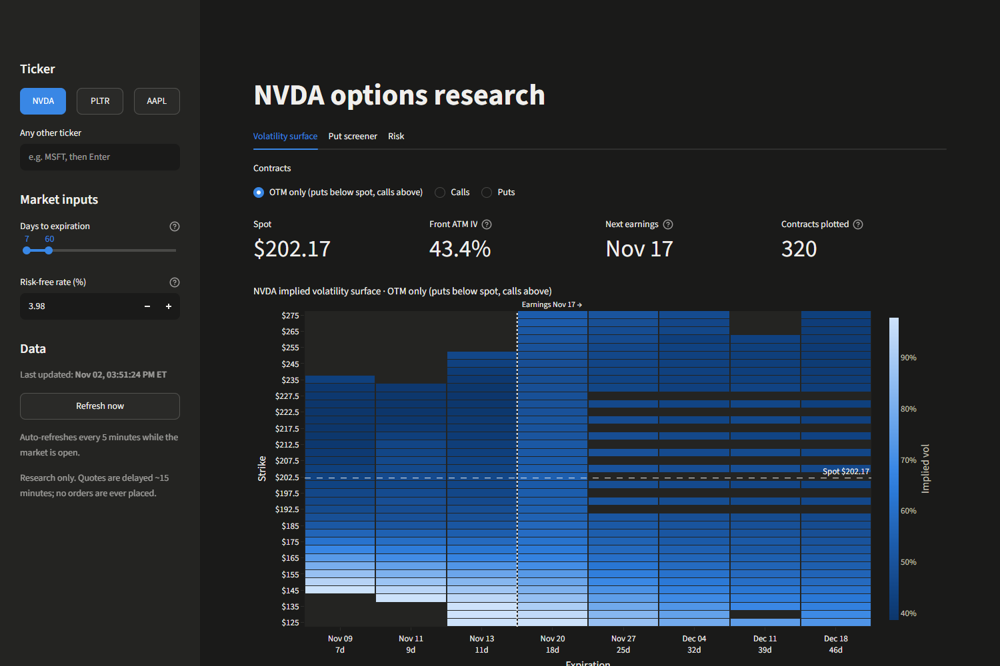
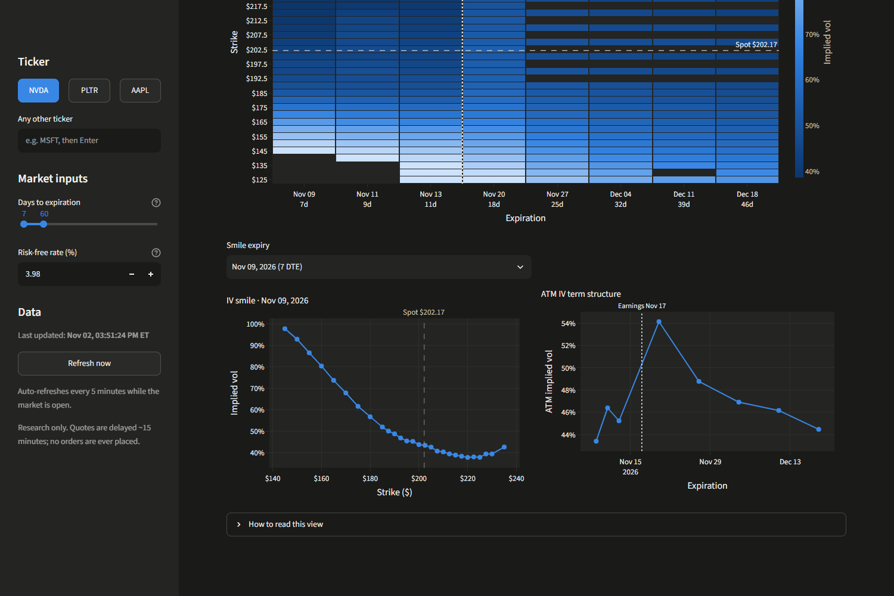
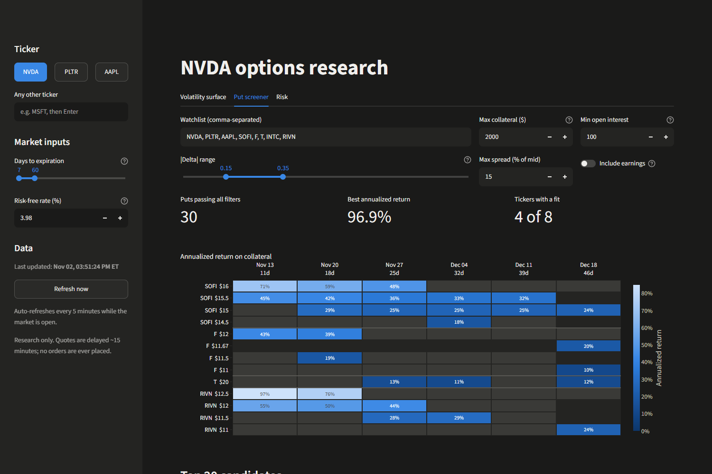
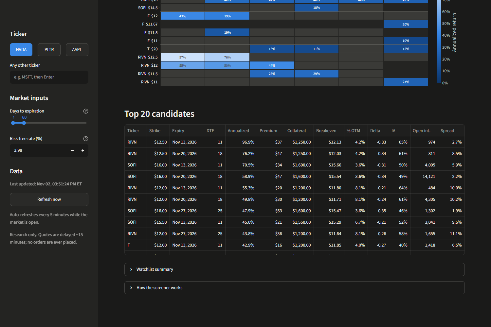
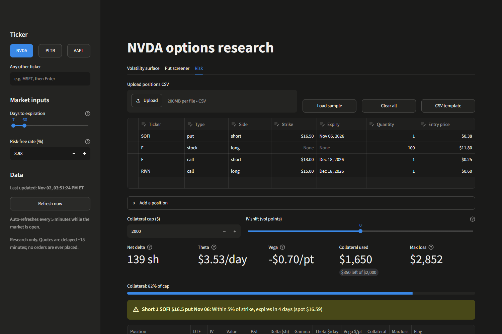
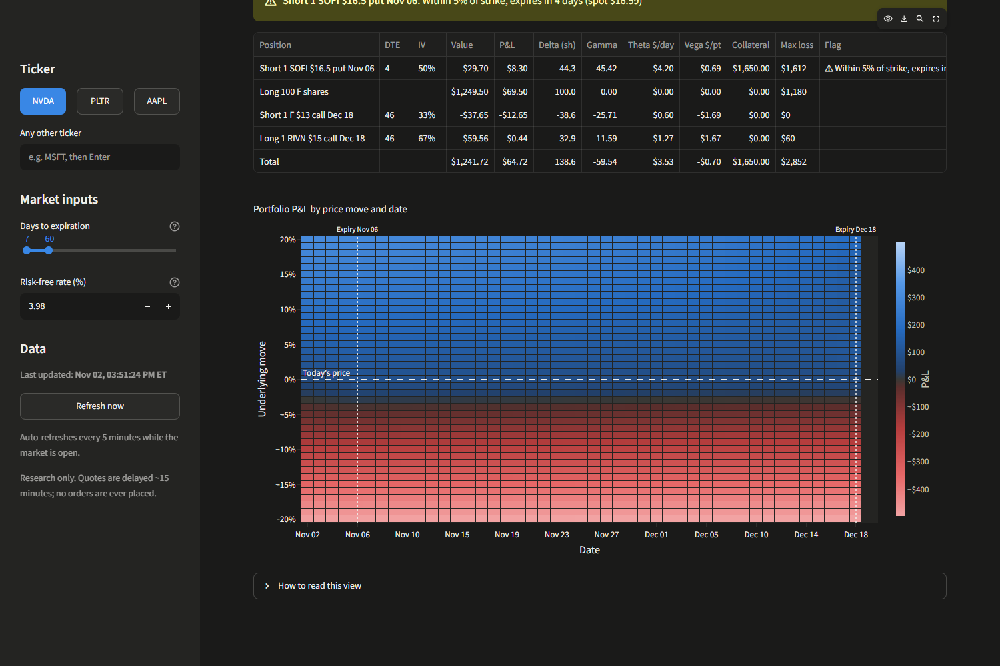

# Options Research Dashboard

A live options research dashboard built with Streamlit and Plotly. It answers three questions a
retail options trader asks every week:

1. **How is the market pricing risk for this stock?** — an implied volatility surface, smile and term structure.
2. **Which cash-secured puts pay best for the collateral I have?** — a screener ranked by annualized return.
3. **What happens to my positions if the stock moves?** — portfolio Greeks, assignment flags and a P&L scenario grid.

It is **research only**: it reads market data and never places orders or connects to a brokerage
account.



---

## Contents

- [Quick start](#quick-start)
- [The three views](#the-three-views)
  - [1. Volatility surface](#1-volatility-surface)
  - [2. Cash-secured put screener](#2-cash-secured-put-screener)
  - [3. Portfolio risk](#3-portfolio-risk)
- [The math](#the-math)
- [Data sources and limitations](#data-sources-and-limitations)
- [Project structure](#project-structure)
- [Deploying to Streamlit Community Cloud](#deploying-to-streamlit-community-cloud)
- [Testing](#testing)

---

## Quick start

Requires Python 3.11 or newer.

```bash
git clone <your-repo-url>
cd <repo-folder>
python -m venv .venv
```

Activate the environment (`.venv\Scripts\activate` on Windows, `source .venv/bin/activate` on macOS/Linux), then:

```bash
pip install -r requirements.txt
streamlit run app.py
```

The app opens at <http://localhost:8501>. No API key is needed: the default data source is
Yahoo Finance via [`yfinance`](https://github.com/ranaroussi/yfinance).

To change the data source, copy `.env.example` to `.env` (it is gitignored) and edit it.

---

## The three views

The sidebar controls all three tabs:

- **Ticker:** NVDA / PLTR / AAPL presets, or type any symbol.
- **Days to expiration:** which expiries to load (default 7–60 days).
- **Risk-free rate:** pre-filled from the 13-week T-bill yield (`^IRX`) and editable.
- **Refresh:** a "Last updated" time and a **Refresh now** button. While the US market is open, the
  page also refreshes itself every 5 minutes.

### 1. Volatility surface



**What it shows.** Implied volatility (IV) for every liquid strike and expiry, as a heat map. Each
cell's hover shows strike, expiry, days to expiry, IV, bid/ask, volume and open interest. You can
show calls, puts, or **OTM only** (puts below spot, calls above), which is how traders usually
build a single surface because out-of-the-money options are the most liquid and their prices are
mostly volatility rather than intrinsic value.

Below the heat map:

- a **smile** chart for one expiry (IV against strike);
- an **ATM term structure** chart (at-the-money IV against expiry);
- a dotted line marking the **next earnings date** on both the heat map and the term structure.

**Why it matters to a trader.**

- **IV is the price of an option, quoted in volatility units.** A 40% IV means the market is
  pricing roughly a ±40% one-standard-deviation move over a year (about ±2.5% a day). Comparing
  IV across strikes and dates tells you where options are cheap or expensive relative to each other.
- **Skew.** For most stocks, puts below spot trade at higher IV than calls above it (the smile
  slopes down to the right). That is the market charging extra for crash protection. A steeper skew
  means more fear of a drop.
- **Earnings kink.** Expiries just after an earnings report carry the expected earnings move, so
  the term structure jumps at the first post-earnings expiry and then decays. In the screenshot,
  NVDA's ATM IV rises from ~44% to ~54% across its Nov 17 report. Selling options that straddle
  earnings means being paid for (and exposed to) that jump.
- **Term structure shape.** Normally longer expiries have higher IV (upward sloping). An inverted
  curve, with near-term IV above long-term, usually signals an event or stress right now.

**How the data is cleaned.**

| Step | Rule |
|---|---|
| Price each contract | Bid/ask midpoint. After hours, see [the after-hours fallback](#data-sources-and-limitations). |
| Skip illiquid strikes | Drop a contract if it has no price, a bid/ask spread wider than 50% of the mid, fewer than 10 open interest **and** no volume today, or a strike more than 40% from spot. |
| Check the provider's IV | Use the provider's IV if it is between 1% and 500%. |
| Recompute junk IV | Otherwise solve Black-Scholes for the IV that matches the mid. These cells get an open-circle marker on the heat map and in the smile, so you can see which numbers are ours. |
| Keep the grid readable | Strikes listed in fewer than half the expiries are dropped from the heat map, so it isn't striped by one-off strikes. |

### 2. Cash-secured put screener



**What a cash-secured put is.** Selling a put means taking a premium today in exchange for agreeing
to buy 100 shares at the strike price if the stock is below the strike at expiry. "Cash-secured"
means you set aside `strike × 100` in cash so you can always pay for the shares. It is a common way
to earn income on cash, or to get paid while waiting to buy a stock at a lower price.

**What it shows.** For every stock in a watchlist (default NVDA, PLTR, AAPL, SOFI, F, T, INTC,
RIVN), every put that fits the filters, scored by **annualized return on collateral**:

- a heat map of ticker/strike × expiry, where cells that fail a filter are **greyed out**, with the
  reason in the hover;
- a sortable top-20 table with premium, collateral, breakeven, % out of the money, delta, IV, open
  interest and spread.

| Filter | Default | Why |
|---|---|---|
| Max collateral | $2,000 | `strike × 100` must fit your cash. With $2k, only strikes ≤ $20 qualify. |
| \|Delta\| range | 0.15–0.35 | Delta roughly approximates the chance the put finishes in the money (you get assigned). 0.15–0.35 is the usual "paid enough, but probably not assigned" zone. |
| Min open interest | 100 | Thin contracts have unreliable prices and are hard to close. |
| Max spread | 15% of mid | A wide bid/ask means you won't actually be filled at the mid. |
| Include earnings | Off | By default, expiries after the next earnings date are greyed out. Their premium is richer because you are being paid to take the earnings gap risk. |

**Why it matters.** A raw premium doesn't compare well: $50 on a $20 strike for 7 days is a very
different deal from $50 on a $50 strike for 45 days. Annualizing return on the cash tied up puts
every trade on the same scale. The screener also shows the trade-off: higher returns come with
higher delta (more assignment risk), higher IV (a more volatile stock) or an earnings event.



### 3. Portfolio risk



**Positions.** Upload a CSV, edit rows in the table, or use the **Add a position** form. A sample
portfolio loads by default ([`data/sample_positions.csv`](data/sample_positions.csv)); **CSV template**
downloads it as a starting point.

```csv
ticker,type,side,strike,expiry,quantity,entry_price
SOFI,put,short,16.5,2026-11-06,1,0.38
F,stock,long,,,100,11.80
F,call,short,13,2026-12-18,1,0.25
RIVN,call,long,15,2026-12-18,1,0.60
```

`type` is `call`, `put` or `stock`; `side` is `long` or `short`; `quantity` is contracts for options
and shares for stock; `entry_price` is per share. Bad rows are skipped with a message (for example
"Row 3: SOFI put expired on Oct 01, 2026") and never block the rest. Positions stay in your browser
session; nothing is saved or sent anywhere.

**What it shows.**

- **Greeks per position and in total**, from your point of view (a short put shows positive delta
  and positive theta, as a broker would):
  - **Delta (shares):** how many shares of stock the position behaves like. +44 means you make about
    $44 for each $1 rise in the stock.
  - **Gamma:** how fast delta changes per $1 move. Short options have negative gamma: moves against
    you accelerate.
  - **Theta ($/day):** what one day passing is worth, all else equal. Option sellers collect it.
  - **Vega ($/vol point):** P&L if implied volatility rises by one point. Option sellers lose when IV rises.
- **Collateral used** for cash-secured puts against a cap you set (default $2,000).
- **Max loss** at expiry: premium paid for long options, `(strike − premium) × 100` for short puts
  (the stock goes to zero after assignment), and "Unlimited" for uncovered short calls or short stock.
  Short calls backed by 100 long shares per contract are recognized as **covered**.
- **Flags** for short puts that are in the money, or within 5% of the strike with fewer than 7 days
  left. Both at once ("assignment likely") and uncovered short calls get the stronger warning.



**P&L heat map.** Portfolio profit or loss for an underlying move from −20% to +20% (rows) on each
date from today to the last expiry (columns). Blue is profit, red is loss, and grey is break-even at
$0, with the color scale centered on zero so equal gains and losses look equally strong. An **IV
shift** slider (±20 vol points) shows what happens if volatility jumps or collapses.

**Why it matters.** The Greeks describe small moves *today*. The grid shows big moves *over time*:
how theta builds up for a seller, how a short put's loss accelerates below the strike, and how
everything converges to its payoff at expiry. A trader uses it to answer "how far can the stock
fall before this hurts, and does waiting help or hurt?"

---

## The math

All pricing is in [`pricing.py`](pricing.py), vectorized with NumPy and tested against textbook
values from Hull, *Options, Futures, and Other Derivatives*.

**Black-Scholes-Merton** with a continuous dividend yield *q*:

$$
d_1 = \frac{\ln(S/K) + (r - q + \tfrac{1}{2}\sigma^2)\,T}{\sigma\sqrt{T}}, \qquad d_2 = d_1 - \sigma\sqrt{T}
$$

$$
C = S e^{-qT} N(d_1) - K e^{-rT} N(d_2), \qquad P = K e^{-rT} N(-d_2) - S e^{-qT} N(-d_1)
$$

where *S* is spot, *K* strike, *T* years to expiry, *r* the risk-free rate, *σ* volatility and *N*
the standard normal CDF.

**Greeks** (per share; the dashboard multiplies by 100 per contract):

| Greek | Call | Put | Units shown |
|---|---|---|---|
| Delta | $e^{-qT}N(d_1)$ | $e^{-qT}(N(d_1) - 1)$ | per 1-dollar move |
| Gamma | $\dfrac{e^{-qT}\,n(d_1)}{S\sigma\sqrt{T}}$ | same | per 1-dollar move |
| Vega | $S e^{-qT}\,n(d_1)\sqrt{T}$ | same | per 1 vol point (÷100) |
| Theta | $-\dfrac{S e^{-qT} n(d_1)\sigma}{2\sqrt{T}} - rKe^{-rT}N(d_2) + qSe^{-qT}N(d_1)$ | $-\dfrac{S e^{-qT} n(d_1)\sigma}{2\sqrt{T}} + rKe^{-rT}N(-d_2) - qSe^{-qT}N(-d_1)$ | per calendar day (÷365) |
| Rho | $KTe^{-rT}N(d_2)$ | $-KTe^{-rT}N(-d_2)$ | per 1 rate point (÷100) |

*n* is the standard normal density.

**Implied volatility** is the σ that makes the Black-Scholes price equal the market price, found with
Brent's method (`scipy.optimize.brentq`) between 0.01% and 500%. If the price is outside the
no-arbitrage bounds (below intrinsic value, for example) there is no answer and the contract is skipped.

**Time to expiry** is measured to the 4:00 pm ET close on the expiry date, in calendar time
(seconds ÷ 365 days), so a 0-DTE option at noon still has four hours of value.

**Screener:**

$$
\text{annualized return} = \frac{\text{mid premium} \times 100}{\text{strike} \times 100} \times \frac{365}{\text{DTE}}
\qquad
\text{breakeven} = \text{strike} - \text{mid premium}
\qquad
\%\,\text{OTM} = \frac{\text{spot} - \text{strike}}{\text{spot}}
$$

Annualizing assumes you could repeat the same trade back to back, which you can't exactly. It is a
comparison tool, not a forecast.

**Risk grid:** each cell reprices every option with Black-Scholes at the scenario price
`spot × (1 + move)`, the remaining time to expiry on that date, and today's IV plus the IV shift.
P&L is `(scenario value − entry price) × quantity × 100` (× 1 for stock), summed over positions.

---

## Data sources and limitations

The default provider is **Yahoo Finance via `yfinance`**: free and keyless, but unofficial and
not real-time. Read the numbers with these limits in mind:

- **Quotes are delayed** about 15 minutes, and data is cached for 5 minutes on top of that. The
  sidebar shows when the data was fetched.
- **The after-hours fallback.** Outside market hours Yahoo reports a bid and ask of zero, so there is
  no mid. The app then falls back to the **last trade price** if that trade happened in the last 5
  days, labels the view as using last trades, and recomputes IV from that price. Last trades can be
  hours old and far from where the option would trade now, so treat after-hours IVs and returns as rough.
- **Returns assume a fill at the mid.** In practice a seller often gets less than the midpoint,
  especially on wide markets. The spread filter limits how much this matters.
- **IV assumptions.** Recomputed IVs use Black-Scholes with continuous dividends, which treats
  American-style equity options as European. The early-exercise premium is small for most
  out-of-the-money options but not for deep in-the-money puts or calls before a dividend.
  The dividend yield is the trailing 12-month dividend ÷ spot.
- **Earnings-date gaps.** Yahoo only lists the *next* earnings date, and often has none for a few
  weeks right after a company reports. When it's missing, the app shows "n/a" and the
  screener's earnings filter can't grey anything out.
- **Risk grid simplifications:**
  - every ticker moves by the same percentage in a scenario (no correlations);
  - IV is held constant across the grid, apart from the parallel IV shift (in reality the smile
    moves with the stock, and IV usually rises when stocks fall);
  - after an option expires it is held at intrinsic value, as if exercised or assigned at that price;
  - total max loss adds up each position's worst case, which overstates the loss on spreads.
- **Each position's IV** is read off the current smile for its strike and nearest listed expiry. A
  ticker with no usable quotes falls back to 50%.
- **The sample portfolio goes stale.** Its SOFI put expires on Nov 6, 2026; after that date it is
  skipped with an "expired" message. Edit the dates in `data/sample_positions.csv` to refresh it.
- **Yahoo can rate-limit** heavy use. If a ticker fails, the app shows a message for that ticker
  and carries on with the rest.

### Adding a real-time provider

Providers implement the small interface in [`providers/base.py`](providers/base.py):
`get_spot`, `get_expirations` and `get_chain`, plus optional earnings date, dividend yield and
risk-free rate. A documented [Tradier](https://documentation.tradier.com/) stub is in
[`providers/tradier_provider.py`](providers/tradier_provider.py), mapping each method to its
read-only market-data endpoint. Once it's implemented, set `DATA_PROVIDER=tradier` and
`TRADIER_TOKEN` in `.env` or Streamlit secrets. The app only ever calls market-data endpoints.

---

## Project structure

```text
app.py                    Streamlit entry point: page setup, tabs, auto-refresh, error handling
pricing.py                Black-Scholes prices, Greeks and implied volatility
market_hours.py           NYSE hours, holidays and time-to-expiry
providers/
  base.py                 DataProvider interface, chain schema, friendly error types
  yfinance_provider.py    Default provider (Yahoo Finance)
  tradier_provider.py     Real-time provider stub (read-only endpoints)
analytics/
  surface.py              Clean a chain, fill IV, build the surface, smile and term structure
  screener.py             Cash-secured put returns, filters and ranking
  risk.py                 Position parsing, Greeks, collateral, max loss, flags, P&L grid
ui/
  sidebar.py              Ticker, DTE range, rate, refresh controls
  data.py                 Cached data loading (parallel chain fetches)
  charts.py               Plotly figures
  theme.py                Colors and the Plotly dark template
  tab_surface.py          Tab 1
  tab_screener.py         Tab 2
  tab_risk.py             Tab 3
data/sample_positions.csv Sample portfolio
tests/                    pytest suite (runs offline)
.streamlit/config.toml    Dark theme
```

The `analytics` and `pricing` modules don't import Streamlit, so all the finance logic is plain
Python and is tested without a browser or network.

---

## Deploying to Streamlit Community Cloud

1. **Push the repo to GitHub** (public or private). Check that `.env` is not in it:
   `git ls-files .env` should print nothing.
2. Go to [share.streamlit.io](https://share.streamlit.io), sign in with GitHub and click
   **Create app → Deploy a public app from GitHub**.
3. Pick the repository and branch, and set **Main file path** to `app.py`.
4. Open **Advanced settings**:
   - **Python version:** 3.12.
   - **Secrets** (optional, only to change the provider):
     ```toml
     DATA_PROVIDER = "yfinance"
     ```
     Top-level secrets are exposed to the app as environment variables, which is where
     `providers/__init__.py` reads them. Put any API token here, never in the repo.
5. Click **Deploy**. The first build installs `requirements.txt` and takes a few minutes. Later
   pushes to the branch redeploy automatically.

Notes:

- `.streamlit/config.toml` is committed, so the dark theme carries over.
- Community Cloud apps sleep after a period without visitors; the first visit after that takes a
  short while to wake up.
- Yahoo sometimes rate-limits shared cloud IP addresses. If quotes fail on the hosted app but work
  locally, that's the cause, and a keyed provider such as Tradier is the fix.

---

## Testing

```bash
python -m pytest
```

The suite runs offline and covers:

- **Pricing:** Hull's textbook values (call 4.76 / put 0.81, the dividend-paying index option, and
  the full Greeks example), put-call parity, Greeks against finite differences, IV round trips and
  edge cases (expiry, zero vol, impossible prices).
- **Market hours:** trading days, holidays and time to the 4 pm close.
- **Providers:** normalizing a Yahoo chain into the shared schema and skipping failed expiries.
- **Surface, screener and risk:** synthetic chains with known IVs, every screener filter, CSV
  parsing errors, covered-call detection, max loss, flags and the P&L grid.

---

*Research and education only. Not investment advice. No orders are ever placed.*
